# Hi, I'm Chris Abner 👋

**Senior Full-Stack Developer** in Cancún, México. I build web products with **PHP/Laravel, Vue 3, Inertia.js and AWS**, and I contribute fixes to the PHP and Laravel open-source ecosystem.

---

## 🔥 Cordon Modulith

**Verifiable boundaries between the modules of a Laravel application, checked in CI.**

Folders don't stop the `Billing` module from reaching into `Catalog`'s models. Cordon Modulith parses your code statically (it never loads or runs it), builds the dependency graph between modules and fails the build when a module:

- uses **internal classes** of another module instead of its public API,
- depends on a module it **did not declare**, or
- takes part in a **dependency cycle**.

It works with nwidart/laravel-modules, InterNACHI/modular or a plain `app/Modules` folder, supports a baseline for existing projects, and also runs as a Pest expectation, a PHPStan rule and a GitHub Action. `php artisan cordon:docs` generates Mermaid diagrams of the real architecture.

```bash
composer require --dev chrisabner/cordon-modulith
php artisan cordon:verify
```

[](https://github.com/ChrisAbner/Cordon-Modulith/actions/workflows/tests.yml)
[](https://packagist.org/packages/chrisabner/cordon-modulith)

📖 [Documentation](https://chrisabner.github.io/Cordon-Modulith/) · 📦 [Packagist](https://packagist.org/packages/chrisabner/cordon-modulith) · 💻 [Repository](https://github.com/ChrisAbner/Cordon-Modulith)

## 🤝 Open source

Selected merged pull requests:

- **[php/php-src#25286](https://github.com/php/php-src/pull/25286)**: in PHP 8.6, `array_map()` with a first-class callable called the wrong function inside a namespace or with `use function`. Fixed before the 8.6.0 release.
- **[php/php-src#25383](https://github.com/php/php-src/pull/25383)**: with the tracing JIT, `++`/`--` on a reference (`global`, `static`, `&$v`) could return its integer result read as a float, so `4` came back as `4.4E-323`. A regression since PHP 8.4.0, fixed in 8.4 and later.
- **[laravel/cashier-stripe#1886](https://github.com/laravel/cashier-stripe/pull/1886)**: Cashier accepts `amount_off` coupons with a `forever` duration, which Stripe allows again.
- **[doctrine/DoctrineBundle#2324](https://github.com/doctrine/DoctrineBundle/pull/2324)**: `find()` no longer refreshes managed entities on ORM < 3.7, which ran an extra query and discarded their unflushed changes.
- **[pestphp/pest#2002](https://github.com/pestphp/pest/pull/2002)**: PHPUnit extensions can register event subscribers again in `--parallel` mode (based on a fix proposed by @stsepelin in [pestphp/pest#1685](https://github.com/pestphp/pest/pull/1685)).

[All my merged pull requests](https://github.com/search?q=author%3AChrisAbner+is%3Apr+is%3Amerged+-user%3AChrisAbner&type=pullrequests)

## 🛠️ Also building

- **[PromoInvestor](https://promoinvestor.com)**: fintech rates comparator for Mexico (Laravel, Laravel Cloud).

## 🧰 Stack


## 📊 GitHub stats




## 📫 Find me

🌐 [chrisabner.github.io](https://chrisabner.github.io) · 💼 [LinkedIn](https://www.linkedin.com/in/chrisabnerr)
